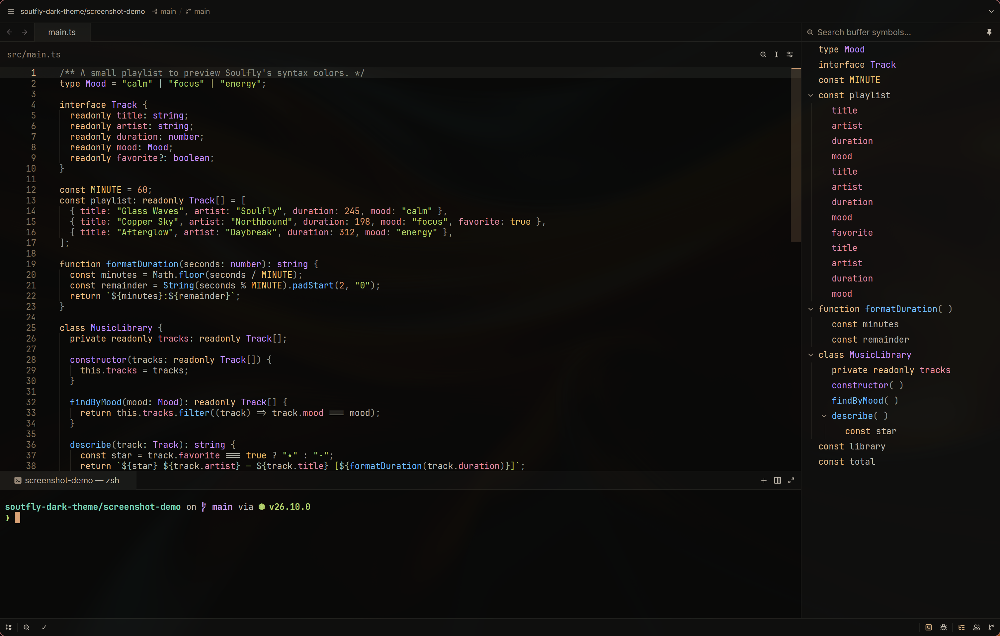

# Soulfly Dark

A warm dark theme for [Zed](https://zed.dev), created by
[Aleksandr Ovcharenko (@pridees)](https://github.com/pridees).

The screenshot shows the Zed IDE window with background transparency enabled.

Near-black surfaces, soft neutral text, sand keywords, rose properties,
blue functions, violet types, and green strings. Includes matching editor,
interface, diagnostic, collaboration, and integrated terminal colors.

## Install

After the extension is published in the Zed registry:

1. Open **Extensions** in Zed and search for **Soulfly Dark**.
2. Install the extension.
3. Run **theme selector: toggle** from the command palette and select **Soulfly Dark**.

## Try the theme locally

1. Clone this repository.
2. Open Zed's command palette and run **zed: install dev extension**.
3. Select the repository directory containing `extension.toml`.
4. Open the theme selector and choose **Soulfly Dark**.

Alternatively, copy `themes/soulfly-dark.json` to `~/.config/zed/themes/`
(Linux or macOS), then select **Soulfly Dark** in Zed.

## Palette

| Role | Color |
| --- | --- |
| Editor background | `#090908` |
| Editor foreground | `#c4beb3` |
| Accent | `#ac6766` |
| Keywords | `#ECC18E` |
| Properties | `#E58EA5` |
| Functions | `#72bfff` |
| Types | `#c792ff` |
| Strings | `#b5d86d` |
| Numbers | `#d9976e` |

## Publishing

See [PUBLISHING.md](PUBLISHING.md) for the Zed registry submission process.

## License

Copyright (c) 2026 Aleksandr Ovcharenko. Released under the [MIT License](LICENSE).
